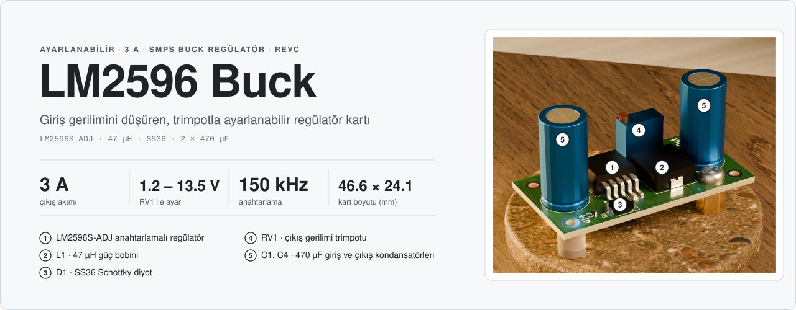
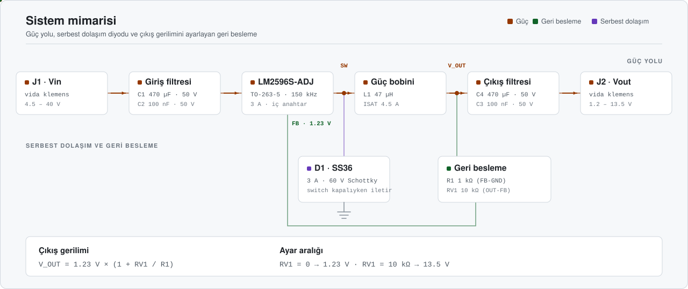
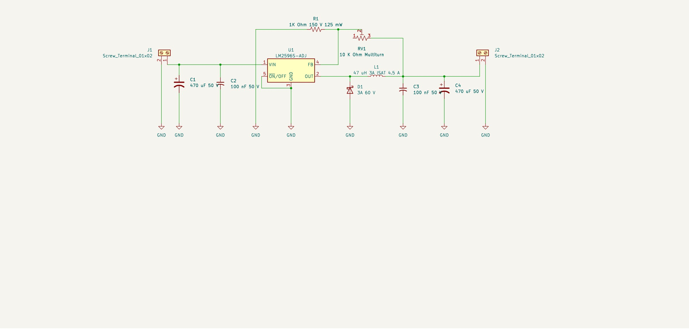
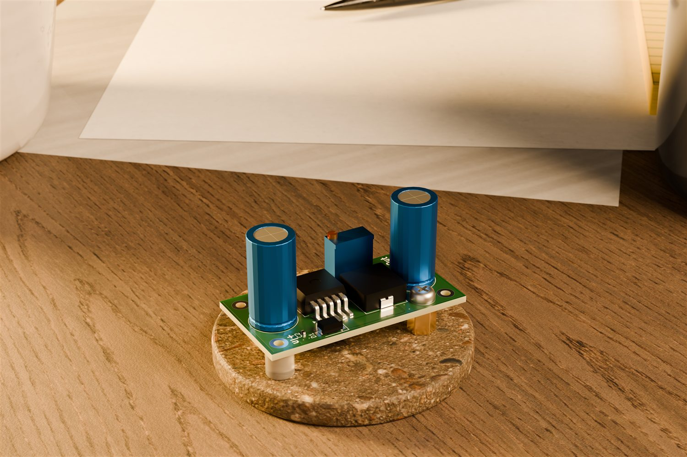
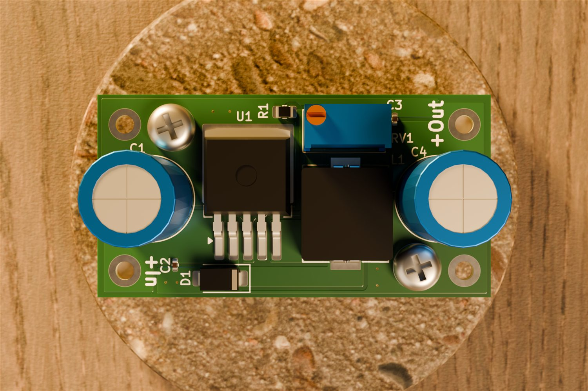

<div align="center">



<br/>

<a href="#-donanım"></a>
<a href="#-revizyonlar"></a>
<a href="#-malzeme-listesi"></a>


<br/><br/>

**Giriş gerilimini düşürüp çıkışa aktaran, trimpotla ayarlanabilir 3 A buck regülatör kartı.**<br/>
LM2596-ADJ ile kurulu bir SMPS (anahtarlamalı güç kaynağı) devresi; üç revizyonda küçültülerek üretime hazır hale getirildi.

</div>


## İçindekiler

- [Genel bakış](#-genel-bakış)
- [Öne çıkanlar](#-öne-çıkanlar)
- [Sistem mimarisi](#-sistem-mimarisi)
- [Çalışma prensibi](#-çalışma-prensibi)
- [Donanım](#-donanım)
- [Tasarım hesapları](#-tasarım-hesapları)
- [Simülasyon](#-simülasyon)
- [Şematik](#-şematik)
- [PCB](#-pcb)
- [Revizyonlar](#-revizyonlar)
- [Malzeme listesi](#-malzeme-listesi)
- [Depo yapısı](#-depo-yapısı)

## ◆ Genel bakış

Bu projede giriş gerilimi düşürülerek çıkışa aktarılır. Giriş gerilimini düşüren bu tip devrelere **SMPS** (Switched-Mode Power Supply) denir; bu projede **LM2596S-ADJ** kullanılmıştır. Çıkış gerilimi, geri besleme bölücüsündeki **RV1** trimpotuyla ayarlanır.

| Özellik | Değer |
|---|---|
| **Regülatör** | LM2596S-ADJ · TO-263-5 · 150 kHz anahtarlama (datasheet) |
| **Çıkış akımı** | 3 A |
| **Giriş gerilimi** | LM2596 için 4.5 – 40 V (datasheet); kondansatörler 50 V |
| **Çıkış gerilimi** | 1.23 V (RV1 = 0) – 13.5 V (RV1 = 10 kΩ), $V_{OUT} = 1.23 \times (1 + R_{V1}/R_1)$ |
| **Bobin** | L1 47 µH · doyma akımı 4.5 A |
| **Serbest dolaşım diyodu** | D1 SS36 · 3 A · 60 V Schottky |
| **Kondansatörler** | C1, C4 470 µF 50 V · C2, C3 100 nF 50 V |
| **Bağlantı** | Giriş ve çıkış için köşelerde 2.2 mm delikli 4 adet pad (IN+, IN−, OUT+, OUT−) · şematikte J1 / J2 olarak çizilen 3.5 mm vida klemens (DB301V-3.5-2P, LCSC C695629) için PCB'de footprint yoktur |
| **Kart (RevC)** | 46.63 × 24.10 mm · 2 katmanlı · 1.6 mm |
| **Maliyet (RevC)** | ≈ 1.05 USD / kart (100 adet) · ≈ 0.83 USD / kart (1000 adet) |

## ◆ Öne çıkanlar

<table>
<tr>
<td width="50%" valign="top">

**Üç revizyonda küçülen kart**<br/>
RevA 56.85 × 32.82 mm, RevB 60.26 × 24.56 mm, RevC 46.63 × 24.10 mm. RevC, RevA'ya göre kart alanını yaklaşık %40 azaltır (1865 mm² → 1124 mm²).

</td>
<td width="50%" valign="top">

**Üretime hazır**<br/>
Güncel sürüm RevC'nin KiCad projesi depoda; LCSC stok kodlu parça listesi ve maliyet tablosu aşağıdaki Malzeme listesi bölümündedir.

</td>
</tr>
<tr>
<td valign="top">

**Ayarlanabilir çıkış**<br/>
Geri besleme direnci 1 kΩ (R1) ile 10 kΩ'luk çok turlu trimpot (RV1) birlikte çıkış gerilimini belirler; ince ayar için 3296W tipi çok turlu trimpot seçildi.

</td>
<td valign="top">

**Seçilmiş pasif parçalar**<br/>
Girişte ve çıkışta 470 µF / 50 V kondansatörler ani akım ihtiyacını karşılar; 100 nF seramikler yüksek frekanslı gürültüyü bastırır.

</td>
</tr>
</table>

## ◆ Sistem mimarisi

<p align="center">
  
</p>

Güç yolu soldan sağa akıyor: giriş (J1) önce C1 / C2 filtresinden geçip LM2596'nın `VIN` pinine ulaşıyor. LM2596'nın içindeki anahtar, `OUT` (SW) düğümünü yüksek frekansta giriş gerilimine bağlayıp ayırıyor. Anahtar açıldığında D1, bobin akımını serbest dolaşım yoluyla yüke taşıyor. L1 ve C3 / C4 bir LC süzgeç oluşturup çıkış gerilimini düzeltiyor. Çıkış gerilimi R1 ve RV1 ile bölünüp `FB` pinine geri besleniyor; LM2596 bu pini 1.23 V'ta tutacak şekilde duty'yi ayarlıyor.

## ◆ Çalışma prensibi

<p align="center">
  
</p>

Anahtar iletimdeyken (**ON**) akım `V_IN → S → L1 → yük` yolunu izler ve bobin akımı artar. Anahtar açıldığında (**OFF**) bobin akımını sürdürmek ister; D1 iletime geçer ve akım `D1 → L1 → yük` yolunda dolaşarak azalır. Duty oranı çıkış gerilimini belirler:

$$V_{OUT} = D \times V_{IN}$$

## ◆ Donanım

<details open>
<summary><b>Güç katı</b></summary>
<br/>

| Blok | Parça | Not |
|---|---|---|
| Regülatör | U1 LM2596S-ADJ | TO-263-5, 3 A, iç anahtar |
| Bobin | L1 SMMS1040-470M · 47 µH | ISAT 4.5 A · Irms 3 A · DCR 155 mΩ · SMD 11.5 × 10.0 mm (LCSC C149599) |
| Diyot | D1 SS36 · 3 A · 60 V Schottky | DO-214AC (SMA) |
| Giriş kondansatörleri | C1 470 µF 50 V (THT) · C2 100 nF 50 V (0402) | Çıkıştaki ani akım ihtiyacını karşılar ve gerilim çakılmasını önler |
| Çıkış kondansatörleri | C4 470 µF 50 V (THT) · C3 100 nF 50 V (0402) | Çıkıştaki dalgalanmayı (ripple) düşürür |
| Bağlantılar | IN+, IN−, OUT+, OUT− pad'leri | 2.2 mm delikli (3.8 mm pad) lehim noktaları; şematikteki J1 / J2 klemensi PCB'ye yerleştirilmemiştir |

</details>

<details>
<summary><b>Geri besleme</b></summary>
<br/>

- **R1** (1 kΩ, 0805) FB pininden GND'ye bağlıdır.
- **RV1** (10 kΩ, 3296W) çıkış ile FB pini arasında reosta olarak bağlıdır (3 numaralı uç çıkışta, kayar kontak FB'de; 1 numaralı uç boştadır).
- `ON/OFF` pini GND'ye bağlıdır; regülatör her zaman açıktır.

</details>

## ◆ Tasarım hesapları

> Değerler KiCad şematik / PCB dosyalarından (RevC) ve TI LM2596 datasheet'inden (SNVS124G) alınmıştır; her kural için datasheet bölümü belirtilmiştir. Datasheet'te karşılığı olmayan değerler "varsayım" diye işaretlenmiştir.

<details>
<summary><b>Çıkış gerilimi ve geri besleme</b></summary>
<br/>

LM2596 FB pinini $V_{REF} = 1.23\text{ V}$'ta tutar (datasheet 7.8: 1.193 – 1.267 V). R1 FB–GND, RV1 OUT–FB arasında olduğu için (Denklem 5):

$$V_{OUT} = V_{REF} \times \left(1 + \frac{R_{V1}}{R_1}\right) = 1.23\text{ V} \times \left(1 + \frac{R_{V1}}{1\text{ k}\Omega}\right)$$

R1 = 1 kΩ, datasheet'in önerdiği 240 Ω – 1.5 kΩ aralığındadır (9.2.2.2.1). Bölücüden $I_{FB} = 1.23\text{ V} / 1\text{ k}\Omega = 1.23\text{ mA}$ akar; bu, FB bias akımının (tipik 10 nA) yaklaşık $10^5$ katıdır.

| RV1 | V<sub>OUT</sub> | V<sub>FB</sub> toleransıyla |
|---|---|---|
| 0 Ω | 1.23 V | 1.19 – 1.27 V |
| 1 kΩ | 2.46 V | 2.39 – 2.53 V |
| 2 kΩ | 3.69 V | 3.58 – 3.80 V |
| 4 kΩ | 6.15 V | 5.97 – 6.34 V |
| 7 kΩ | 9.84 V | 9.54 – 10.14 V |
| 10 kΩ | 13.53 V | 13.12 – 13.94 V |

3.3 V için $R_{V1} = 1.68\text{ k}\Omega$, 5 V için 3.07 kΩ, 12 V için 8.76 kΩ gerekir. İç anahtarın doyma gerilimi 3 A'de tipik 1.16 V, en fazla 1.4 V (sıcakta 1.5 V); L1'in DCR değeri 155 mΩ (LCSC C149599) olduğundan bobin üzerinde 3 A'de $3 \times 0.155 = 0.47\text{ V}$ düşer. Giriş gerilimi bu yüzden çıkıştan en az $1.16 + 0.47 = 1.63\text{ V}$ (tipik) – $1.4 + 0.47 = 1.87\text{ V}$ (en kötü) yüksek olmalıdır. 10 V'un üzerindeki çıkışlar için datasheet, RV1'e paralel $C_{FF} = 1/(31 \cdot 10^3 \cdot R_2)$ önerir (12 V'ta ≈ 3.7 nF; Tablo 9-6: 1 nF); kartta bu kondansatör yoktur.

RV1'in 1 numaralı ucu boştadır; kayar kontak geçici olarak açık devre olursa FB pinine çıkıştan akım gelmez ve R1 yüzünden FB 0 V'a iner, regülatör duty'yi artırarak çıkışı giriş gerilimine doğru yükseltir. Datasheet'te bu durum anılmaz; trimpotlarda yaygın uygulama, kullanılmayan ucun kayar kontağa bağlanmasıdır.

</details>

<details>
<summary><b>Çalışma noktaları: duty, bobin dalgalanması, tepe akım</b></summary>
<br/>

Datasheet'in duty ifadesi (Denklem 8; $V_{SAT} = 1.16\text{ V}$, $V_D = 0.5\text{ V}$) ve 150 kHz, $L = 47\ \mu\text{H}$ için dalgalanma:

$$D = \frac{V_{OUT} + V_D}{V_{IN} - V_{SAT} + V_D}, \qquad \Delta I_L = \frac{(V_{IN} - V_{SAT} - V_{OUT})\,D}{f_{sw}\,L}, \qquad I_{pk} = I_{LOAD} + \frac{\Delta I_L}{2}$$

| V<sub>IN</sub> → V<sub>OUT</sub> | D | ΔI<sub>L</sub> (pp) | E·T (V·µs) | I<sub>pk</sub> (3 A) | CCM sınırı ΔI<sub>L</sub>/2 |
|---|---|---|---|---|---|
| 12 V → 3.3 V | 0.335 | 0.36 A | 16.8 | 3.18 A | 0.18 A |
| 12 V → 5 V | 0.485 | 0.40 A | 18.9 | 3.20 A | 0.20 A |
| 24 V → 5 V | 0.236 | 0.60 A | 28.0 | 3.30 A | 0.30 A |
| 24 V → 12 V | 0.536 | 0.82 A | 38.7 | 3.41 A | 0.41 A |
| 36 V → 12 V | 0.354 | 1.15 A | 53.9 | 3.57 A | 0.57 A |
| 40 V → 12 V | 0.318 | 1.21 A | 56.9 | 3.60 A | 0.60 A |

Örnek (24 V → 12 V): $D = 12.5 / 23.34 = 0.536$, $\Delta I_L = 10.84 \times 0.536 / (150\text{ kHz} \times 47\ \mu\text{H}) = 0.82\text{ A}$.

</details>

<details>
<summary><b>Bobin kontrolü</b></summary>
<br/>

Datasheet'in örnek tasarımı (9.2.2.2.2, 28 V → 20 V, 3 A) $E \cdot T = 34.2\text{ V}\cdot\mu\text{s}$ bulup 47 µH seçer; kartın 24 V → 12 V noktası 38.7 V·µs olduğundan 47 µH aynı bölgededir. 12 – 24 V girişte tepe akım ≤ 3.41 A, yani ISAT'ın (4.5 A) %76'sıdır. 40 V → 12 V, 3 A noktasında tepe akım 3.60 A olur ve LM2596'nın en küçük akım sınırına (3.6 A, datasheet 7.9) eşittir; bu bölgede 68 µH bobin tercih edilmelidir.

LCSC kaydına göre L1 (SMMS1040-470M): 47 µH ±%20, Irms 3 A, ISAT 4.5 A, DCR 155 mΩ. 3 A'de bakır kaybı $P_L = I^2 \times DCR = 3^2 \times 0.155 = 1.40\text{ W}$'tır ve nominal akım (3 A) ile yük akımı eşittir; yani bobin tam yükte kendi sıcaklık artış sınırında çalışır.

</details>

<details>
<summary><b>Serbest dolaşım diyodu (D1)</b></summary>
<br/>

| Kural (datasheet 9.2.2.2.5) | Gerekli | SS36 | Sonuç |
|---|---|---|---|
| Ters gerilim ≥ 1.25 × V<sub>IN,max</sub> | 1.25 × 40 V = 50 V | 60 V | sağlanıyor |
| Akım ≥ 1.3 × I<sub>LOAD</sub> | 1.3 × 3 A = 3.9 A | 3 A | sağlanmıyor |
| Sürekli kısa devre: akım ≥ I<sub>CL</sub> | 4.5 A (tipik) | 3 A | sağlanmıyor |

Normal çalışmada ortalama diyot akımı $I_D = I_{LOAD}(1 - D)$ ve kaybı $P_D = 0.5\text{ V} \times I_D$: 12 V → 5 V için 1.54 A / 0.77 W, 24 V → 12 V için 1.39 A / 0.70 W, 24 V → 5 V için 2.29 A / 1.15 W. Normal yükte 3 A'lik diyot yeterlidir; kalıcı kısa devre dayanımı için 5 A sınıfı gerekir.

</details>

<details>
<summary><b>Kondansatörler</b></summary>
<br/>

- **C1 (giriş):** RMS akım değeri $\ge I_{LOAD}/2 = 1.5\text{ A}$ ve gerilim değeri $\approx 1.5 \times V_{IN}$ olmalıdır (9.2.2.2.6); 50 V için bu $V_{IN} \le 33\text{ V}$ demektir. RMS değeri üretici datasheet'inden doğrulanmalıdır (şematikte parça numarası yoktur, BOM'daki 01EC4236 kodu doğrulanamadı).
- **C4 (çıkış):** datasheet 82 – 820 µF aralığını ve $\ge 1.5 \times V_{OUT}$ gerilim değerini ister (9.2.2.2.3); 470 µF / 50 V bunu sağlar (13.5 V için gereken 20.3 V).
- **Çıkış dalgalanması:** $V_{rip} = \Delta I_L \cdot ESR$; 24 V → 12 V noktasında kapasitif bileşen $\Delta I_L / (8 f_{sw} C) = 1.5\text{ mV}$ (ihmal edilebilir). ESR bileşeni (ESR varsayım): 0.05 Ω için 41 mV, 0.1 Ω için 82 mV, 0.2 Ω için 165 mV (pp).

$$f_0 = \frac{1}{2\pi\sqrt{L_1 C_4}} = \frac{1}{2\pi\sqrt{47\ \mu\text{H} \times 470\ \mu\text{F}}} \approx 1.07\text{ kHz} \quad\Rightarrow\quad \frac{150\text{ kHz}}{1.07\text{ kHz}} \approx 140$$

</details>

<details>
<summary><b>Güç kaybı ve ısıl kontrol</b></summary>
<br/>

İç anahtarın iletim ve besleme kaybı (alt sınır): $P_{IC,min} = V_{SAT}\,I_{LOAD}\,D + V_{IN}\,I_Q$ ($I_Q = 5\text{ mA}$). Üst sınır, datasheet'in tipik verimlerinden (12 V → 5 V için %80, 25 V → 12 V için %90, 3 A) toplam kayıptan diyot kaybının düşülmesiyle bulunur:

| V<sub>IN</sub> → V<sub>OUT</sub>, 3 A | P<sub>OUT</sub> | η | P<sub>kayıp</sub> | P<sub>D1</sub> | P<sub>L1</sub> (1.40 W) çıkarılınca P<sub>IC</sub> | İletim modeli P<sub>IC</sub> |
|---|---|---|---|---|---|---|
| 12 V → 5 V | 15 W | %80 | 3.75 W | 0.77 W | 1.58 W | 1.75 W |
| 24 V → 12 V | 36 W | %90 | 4.00 W | 0.70 W | 1.90 W | 1.98 W |

İki yöntem birbirine yakındır (1.6 – 2.0 W); yani entegrenin gücü yaklaşık 2 W kabul edilebilir. TO-263 için R<sub>θJA</sub> bakır alanına bağlıdır (datasheet 7.4): 0.5 in² → 50 °C/W, 2.5 in² → 30 °C/W, çift yüzlü 3 in² → 20 °C/W. Kartın tüm alanı $46.63 \times 24.10 = 1124\text{ mm}^2 \approx 1.74\text{ in}^2$ olduğundan 30 – 50 °C/W beklenir. 125 °C sınırı ve 40 °C ortam için izin verilen güç ve 24 V → 12 V, 3 A noktasındaki sıcaklık:

$$P_{IC,max} = \frac{125 - 40}{R_{\theta JA}} = 1.70\text{ W}\ (50\ ^\circ\text{C/W}),\quad 2.83\text{ W}\ (30\ ^\circ\text{C/W}) \qquad T_J = 40 + 1.98 \times R_{\theta JA} = 99\ ^\circ\text{C}\ (30),\quad 139\ ^\circ\text{C}\ (50)$$

R<sub>θJA</sub> = 30 °C/W kadar bakır sağlanıyorsa 3 A tam yük sınırın içindedir; 50 °C/W'ta (az bakır) 125 °C aşılır. Sürekli yük yaklaşık 2 A tutulursa entegre gücü yaklaşık 1.4 W'a (T<sub>J</sub> ≤ 110 °C) düşer. Datasheet 2 A üstünde çift yüzlü kart, geniş bakır alan veya hava akışı önerir (9.4.3); bu nedenle gerçek sıcaklık ölçülmelidir. 24 V → 12 V, 3 A noktasında giriş akımı $36 / (0.9 \times 24) = 1.67\text{ A}$'dir.

</details>

<details>
<summary><b>Seçim gerekçeleri</b></summary>
<br/>

- **Bobin:** RevA'da 68 µH kullanıldı; RevB / RevC'de stok durumu ve maliyet nedeniyle 47 µH (SMMS1040) kullanıldı.
- **Diyot:** Devreden geçecek akım 3 A düzeyinde olacağından serbest dolaşım diyodu Schottky olarak seçildi. RevA'da 5 A'lik bir diyot düşünülmüştü, RevB / RevC'de maliyet için 3 A / 60 V SS36'ya geçildi.
- **Kondansatörler:** Girişte ve çıkışta 50 V dayanımlı 470 µF polarize kondansatörler kullanıldı; RevA'da çıkışta 35 V'luk 220 µF kondansatörler vardı.

</details>

## ◆ Simülasyon

LTspice simülasyon sonucu (Temmuz 2026, tasarımın ilk aşamasında alınmıştır):


## ◆ Şematik

<p align="center">
  
</p>

## ◆ PCB

<table>
<tr>
<td width="50%"></td>
<td width="50%"></td>
</tr>
<tr>
<td align="center"><sub>Hero görünüm (sol önden, 3/4) · RevC</sub></td>
<td align="center"><sub>Üstten görünüm · 46.63 × 24.10 mm</sub></td>
</tr>
</table>

Görseller [DRC Analyzer](https://github.com/Aykut-Gencer-KARACA/DRC-Analyzer) ile projenin 3B modelinden üretilmiştir; tam çözünürlüklü dosyalar `KiCad Project/Renders/` klasöründedir.

## ◆ Revizyonlar

**Güncel sürüm: RevC.** Revizyonlar arasında bileşenler stok durumu ve üretim maliyeti nedeniyle değişmiştir.

| | RevA | RevB | RevC |
|---|---|---|---|
| **Kart boyutu** | 56.85 × 32.82 mm | 60.26 × 24.56 mm | 46.63 × 24.10 mm |
| **Bobin (L1)** | 68 µH | 47 µH (SMMS1040) | 47 µH (SMMS1040) |
| **Giriş kondansatörleri** | 2 × 470 µF 50 V | 470 µF 50 V + 100 nF | 470 µF 50 V + 100 nF |
| **Çıkış kondansatörleri** | 2 × 220 µF 35 V | 470 µF 50 V + 100 nF | 470 µF 50 V + 100 nF |
| **Diyot (D1)** | Schottky (genel) | SS36 (3 A, 60 V) | SS36 (3 A, 60 V) |

RevB ve RevC aynı parça listesini kullanır; RevC bu parçaları daha küçük bir kartta toplar.

> [!NOTE]
> RevA'da LM2596 çıkışına paralel bağlı 220 µF kondansatörler ve 5 A'lik Schottky diyot kullanılmıştı. Depoda yalnızca güncel sürüm RevC'nin dosyaları bulunur.

## ◆ Malzeme listesi

<details>
<summary><b>RevC · parça listesi ve maliyet</b> (LCSC stok kodları ve fiyatları)</summary>
<br/>

| Ref | Açıklama | Parça | Adet | Kılıf | Stok kodu |
|---|---|---|:-:|---|---|
| U1 | Buck regülatör | LM2596S-ADJ | 1 | TO-263-5L | LM2596S-ADJ |
| L1 | Güç bobini 47 µH, ISAT 4.5 A, DCR 155 mΩ | SMMS1040-470M | 1 | SMD 11.5 × 10.0 | C149599 |
| D1 | Schottky diyot 3 A / 60 V | SS36 | 1 | DO-214AC | SS36 |
| C1, C4 | 470 µF 50 V | 01EC4236 (doğrulanamadı); footprint'e uyan örnek: Lelon RGA471M1HBK-1020G | 2 | THT D10 × L20, P = 5 mm | 01EC4236 (örnek: C134595) |
| C2, C3 | 100 nF 50 V | C0402B104K500NT | 2 | 0402 | C0402B104K500NT |
| R1 | 1 kΩ, 125 mW | FRC0805F1001TS | 1 | 0805 | FRC0805F1001TS |
| RV1 | 10 kΩ çok turlu trimpot | 3296W-103-LF | 1 | THT 9.5 × 4.8 mm | 3296W-103-LF |
| J1, J2 | Vida klemens, 2 kutuplu, 3.5 mm (7 A, 300 V) · şematikte tanımlı, PCB'de footprint yok | DB301V-3.5-2P-GN-S | 2 | THT | C695629 |

**Maliyet** (parçalar LCSC fiyatlarıyla, kart başına):

| Adet | Toplam | Kart başına | Klemenssiz kart başına |
|---|---|---|---|
| 100 | 104.88 USD | 1.05 USD | 0.93 USD |
| 500 | 438.00 USD | 0.88 USD | 0.78 USD |
| 1000 | 827.90 USD | 0.83 USD | 0.73 USD |

Maliyetler LCSC birim fiyatlarından hesaplanmıştır; fiyatlar ve stok adetleri değişebilir.

</details>

## ◆ Depo yapısı

```text
LM2596-3A-Buck-Regulator/
├─ KiCad Project/                          KiCad projesi (güncel sürüm: RevC)
│  ├─ LM2596-Buck-Regulator.kicad_pro / _sch / _pcb
│  ├─ Layer_Images/                         Katman görüntüleri, şematik PDF, 3D .glb
│  ├─ Renders/                              Yüksek çözünürlüklü PCB render'ı
│  ├─ EasyEDA.kicad_sym                     Sembol kütüphanesi
│  ├─ EasyEDA.pretty/                       Footprint'ler
│  └─ EasyEDA.3dshapes/                     3D modeller
├─ assets/                                 README görselleri
└─ README.md
```

Projeyi açmak için KiCad'de `KiCad Project/LM2596-Buck-Regulator.kicad_pro` dosyasını açın. Revizyon bilgisi şemanın ve PCB'nin başlık bloğundadır.

<br/>

<div align="center">

<br/>
<sub>LM2596 · 47 µH · SS36 · KiCad</sub>
</div>
